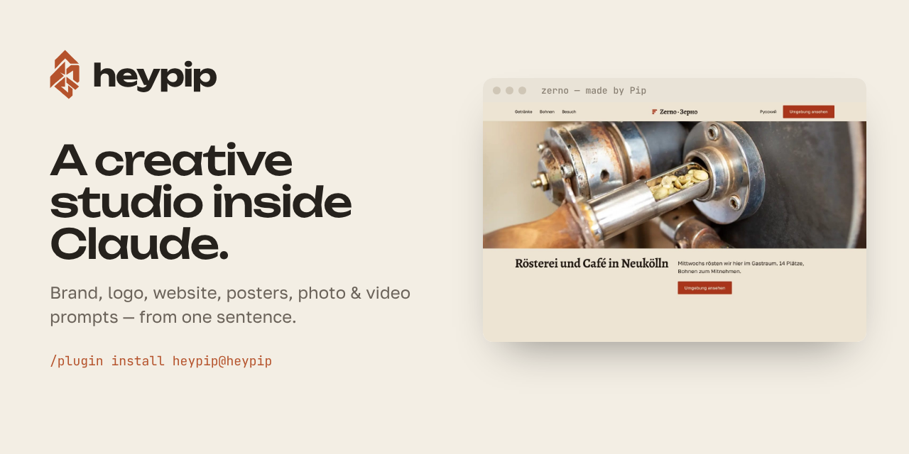
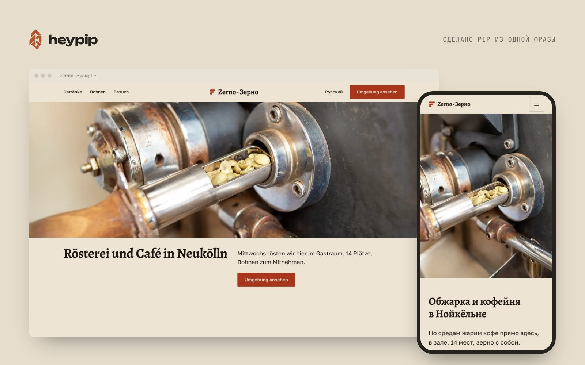
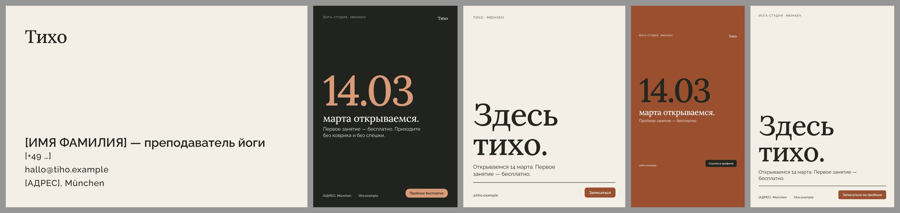
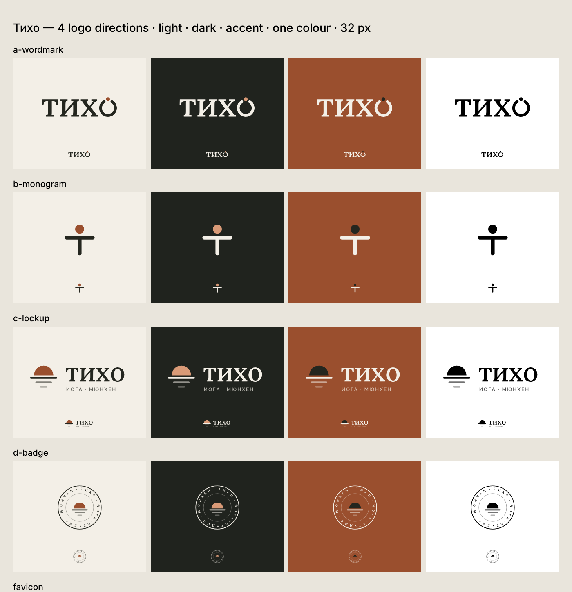

<p align="center">
  
</p>

<p align="center">
  <b>One sentence about your business → brand, logo, website, posters and photo/video prompts that all match.</b><br>
  A plugin for Claude Code and a skill for Claude.
</p>

<p align="center">
  
  
  
  
</p>

<p align="center">
  <a href="#quick-start">Quick start</a> ·
  <a href="#what-pip-makes">What Pip makes</a> ·
  <a href="#examples">Examples</a> ·
  <a href="#commands">Commands</a> ·
  <a href="GUIDE.md">Beginner guide (RU)</a> ·
  <a href="#по-русски">По-русски</a>
</p>

---

## Quick start

In **Claude Code**:

```
/plugin marketplace add Pip-Skill/HeyPip
/plugin install heypip@heypip
/heypip:start
```

Pip asks two or three simple questions and builds the rest. Everything for one brand lands in one folder.

On **claude.ai** or the Claude app: download `heypip.skill` from [Releases](../../releases), then
Customize → Skills → **+** → Upload a skill, and write "Pip, make a brand for …". (That version leaves
out the website engine — claude.ai allows 200 files per skill. Everything else is there.)

## Why Pip

Most AI design tools do one thing: a landing page, *or* a palette, *or* an image prompt — and every
piece comes out looking like a different company. Pip runs the whole studio and keeps it **one brand**:

```
one sentence ─► direction ─► brand.json ─┬─► brand book + tokens
                                         ├─► logo (SVG)
                                         ├─► website
                                         ├─► posters, cards, Instagram
                                         ├─► photo prompts
                                         └─► video script + prompts
```

Change a colour in `brand.json` once — the site, the posters and every prompt follow.

## What Pip makes

| Area | What you get |
|---|---|
| **Brand** | positioning, three directions to choose from, moodboard, colours checked for readability (WCAG), fonts that cover your language, a brand book |
| **Logo** | four SVG directions — wordmark, monogram, symbol + name, badge — tested at 32 px |
| **Website** | a real site built by a full web engine, with self-hosted fonts and checks at 1440 / 1024 / 768 / 390 px |
| **Print & social** | A2–A6 and 50×70 posters, flyers, business cards, Instagram posts and stories — print-ready PDF with 3 mm bleed + PNG |
| **Photo** | a shoot style guide and prompts for Midjourney, Flux and SDXL that share one look |
| **Video** | script with timings, storyboard, motion brief and prompts for Kling, Runway, Luma and Veo |
| **Design tokens** | CSS variables, Tailwind v4 and v3, W3C DTCG (Figma via Tokens Studio), TypeScript |
| **Code** | 9 agents and 15 commands to plan, review, test and ship the code Pip builds |

Under the hood: a design library with 89 styles, 192 palettes, 74 font pairings, 120 UX rules and
rules for 22 stacks — so choices come from data, not guesswork.

## Examples

Made by Pip from one sentence each, nothing retouched by hand.

**Zerno — a roastery café in Berlin-Neukölln**, German + Russian site:



**Tiho — a yoga studio in Munich**: poster, flyer, Instagram post and story, business card, four logo directions:





More in [`examples/`](examples): Lumen & Loom (slow fashion) and Ledgerly (SaaS campaign) with brand
books, tokens, sites, prompts and storyboards.

In side-by-side tests against Claude without Pip (same prompts), Pip passed 12/12 checks vs 8/12:
sites built on design tokens instead of hard-coded colours, one shared look across all prompts,
clear positioning, and a headline that says what the product is.

## Commands

**Design**

| Command | Does |
|---|---|
| `/heypip:start` | guided first project — start here |
| `/heypip:help` | cheat sheet of every command |
| `/heypip:brand` | direction, moodboard, colours, fonts, brand book |
| `/heypip:moodboard` | 2–3 visual directions to choose from |
| `/heypip:system` | design system + tokens from a description or your colours |
| `/heypip:logo` | four logo directions as SVG |
| `/heypip:site` | website or landing page |
| `/heypip:poster` | posters, flyers, business cards, Instagram posts and stories |
| `/heypip:photo` | photo style guide + Midjourney / Flux / SDXL prompts |
| `/heypip:video` | script, storyboard, Kling / Runway / Luma / Veo prompts |
| `/heypip:campaign` | everything above, in one style |
| `/heypip:review` | audit and fix existing work |
| `/heypip:find` | search the design library |

**Code** — `/heypip:plan`, `/heypip:tdd`, `/heypip:code-review`, `/heypip:e2e`, `/heypip:verify`,
`/heypip:build-fix`, `/heypip:test-coverage`, `/heypip:refactor-clean`, `/heypip:checkpoint`,
`/heypip:eval`, `/heypip:learn`, `/heypip:orchestrate`, `/heypip:update-docs`,
`/heypip:update-codemaps`, `/heypip:setup-pm`.

Or just write normally: *"Pip, make an A2 poster and an Instagram story for Saturday's tasting."*

## Writing a good request

Say **what it is, who it's for, what makes it different, and the language of the texts.**

> ✗ "coffee shop"
> ✓ "a neighbourhood roastery café, 14 seats, we roast on Wednesdays right in the room, texts in German"

## Requirements

- Claude Code (for the plugin) or a Claude plan with code execution (for the skill)
- Python 3.9+ for the scripts; Node 22+ and Chrome for websites and PDF/PNG export; npm to self-host fonts

## What Pip runs and connects to

No telemetry; nothing about you or your work is sent anywhere. Scripts run on your machine, and the
network is used only for the steps below, when a task needs them.

| What | When | Network |
|---|---|---|
| Python scripts (`skills/heypip/scripts/`) | tokens, contrast, brand book, moodboard, prompts, print, library search | none |
| `fetch_fonts.py` | self-hosting a site's fonts | font packages from the npm registry (`@fontsource/*`) |
| Web engine (`skills/heypip/taste/`) | building a website | serves pages on `127.0.0.1` for checks; pinned icons from `cdn.jsdelivr.net`; licensed stand-in photos from Wikimedia Commons / Openverse / Picsum |
| Headless Chrome | screenshots, PDF/PNG export, site checks | local only |
| Hooks (`hooks/hooks.json`) | every Claude Code session | none |

Hooks only print hints or write local notes — none blocks a tool call:
session notes in `~/.claude/sessions/` (and learned patterns in `~/.claude/skills/learned/` at session
end); tmux and `git push` reminders; `/compact` suggestions; formatting and type checks after JS/TS
edits with the project's own Prettier and `tsc`; `console.log` warnings; and the web engine's finish
gate, only while a website build is armed. Turn hooks off any time in `/hooks`.

## Tests

```
bash tests/smoke.sh                       # every script on the example brand, offline
claude plugin eval . --allow-tools Write,Edit,Bash   # test cases in evals/
```

## Credits

Pip stands on three open-source projects, all MIT — thank you:

- Web engine: [Taste Skill](https://github.com/Leonxlnx/taste-skill) by Leonxlnx — `LICENSE-taste-skill.txt`
- Design library: [UI/UX Pro Max](https://github.com/nextlevelbuilder/ui-ux-pro-max-skill) by Next Level Builder — `skills/heypip/library/uiux/NOTICE.md`
- Engineering toolkit: [everything-claude-code](https://github.com/affaan-m/everything-claude-code) by Affaan Mustafa — `LICENSE-everything-claude-code.txt`

Pip itself is MIT — see `LICENSE`.

---

## По-русски

**Pip** — креативная студия внутри Claude. Одна фраза о вашем бизнесе — и Pip делает бренд, логотип,
сайт, плакаты, посты и сторис для Instagram, промпты для фото и видео. Всё строится из одного файла
бренда, поэтому везде один стиль: поменял цвет — обновилось всё.

**Установка в Claude Code:**

```
/plugin marketplace add Pip-Skill/HeyPip
/plugin install heypip@heypip
/heypip:start
```

**На claude.ai:** скачайте `heypip.skill` из [Releases](../../releases) → Customize → Skills → **+** →
Upload a skill, и пишите: «Pip, сделай бренд для …».

**Хороший запрос** — что это, для кого, чем отличается и на каком языке тексты:
«кофейня-обжарка для соседей, 14 мест, жарим по средам прямо в зале, тексты на немецком».

Пошаговая обучалка для новичков — [GUIDE.md](GUIDE.md). Лицензия MIT.
